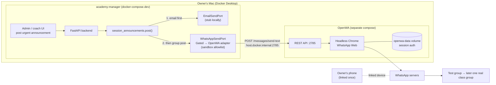
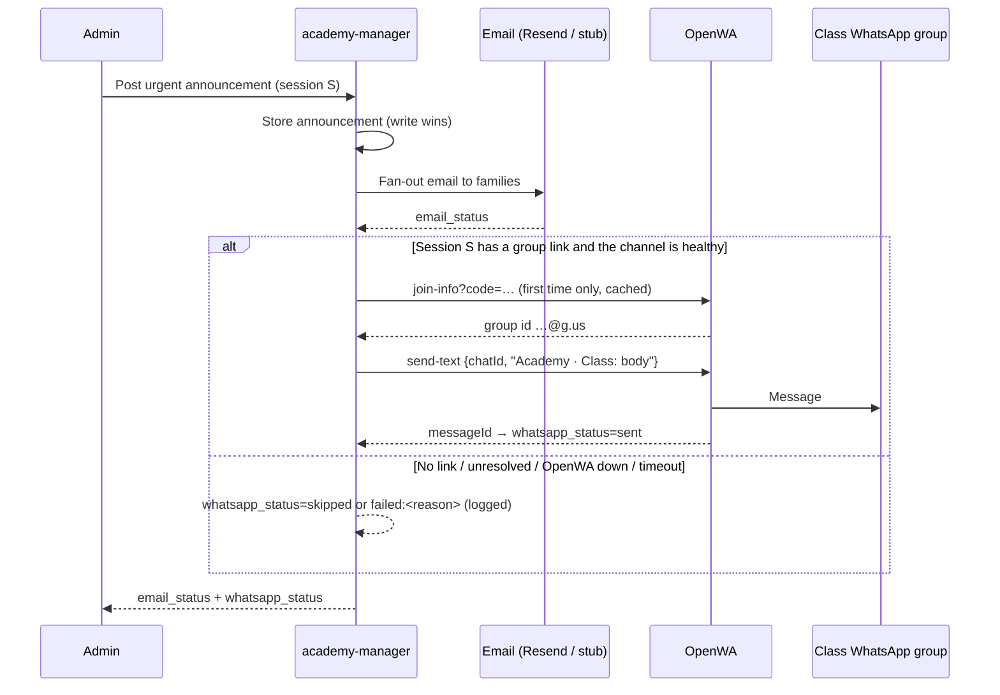
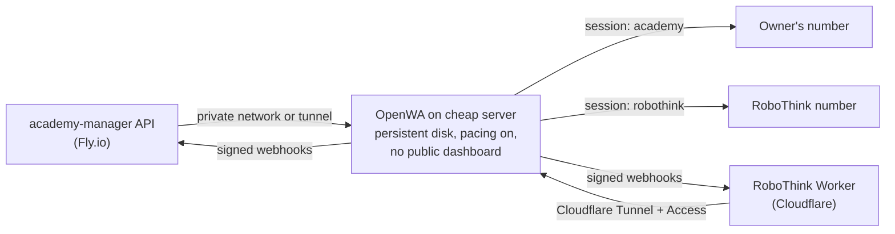

# PRD — WhatsApp Notifications via OpenWA (Academy pilot → RoboThink)

**Status:** Draft for planning
**Date:** 2026-10-25
**Owner:** RamC
**Companion docs:** [design.md](design.md) (technical design), [handoff.md](handoff.md) (brief for the build session)

---

## 1. Problem statement

Academy families live in WhatsApp. Each class already has a WhatsApp group, and academy-manager
already emails parents the group links. But everything academy-manager sends (urgent class
changes, dues reminders, absence confirmations) goes out **only by email**, which parents open late
or not at all. Urgent news like "class cancelled tonight" ends up being re-typed by hand into
WhatsApp groups. That's duplicate work for the owner, and families who miss the email miss the
change.

RoboThink has the mirror problem. Booth visitors leave contact details, but follow-up is email-only,
and the warmest leads would rather chat.

**Cost of not solving it:** manual re-posting, missed cancellations, slower dues collection, and cold
RoboThink leads.

## 2. Approach in one paragraph

Run **OpenWA** (self-hosted WhatsApp gateway) in Docker on the owner's Mac. Link it to the owner's
WhatsApp, which is already the admin of the class groups. Have academy-manager **post urgent
announcements into the matching class WhatsApp group** in addition to the email it already sends.
Prove it end to end locally with a test group, then one real class. Only then move OpenWA to a cheap
always-on server, and reuse the same pieces for RoboThink.

## 3. Goals

| # | Goal | Measured by |
|---|---|---|
| G1 | Urgent class announcements reach the class WhatsApp group automatically | 100% of urgent announcements for mapped sessions produce a group post, or a logged reason why not |
| G2 | WhatsApp never makes email worse | 0 email sends lost or delayed because of WhatsApp failures (tested by stopping OpenWA) |
| G3 | The owner stops re-typing announcements | Owner reports zero manual re-posts for piloted classes over 2 weeks |
| G4 | The owner knows within minutes if WhatsApp is disconnected | Disconnect → alert email in under 5 minutes |
| G5 | The path to a server and to RoboThink is documented, not guessed | A "what goes on the server" checklist exists by the end of phase 2 |

## 4. Non-goals (this phase)

- **Individual parent DMs** (dues, absences). They need the opt-in and consent work in design.md §7.
  That's phase 3, after groups are proven.
- **Bulk or promotional messages.** These are the main ban trigger for unofficial gateways.
- **Auto-adding parents to groups.** Adding people who never interacted with the number is a known
  ban signal. Invite links by email stay.
- **Multi-tenant or per-academy numbers.** The pilot is the owner's academy on the owner's number.
- **Production hosting.** Phases 1–2 run on the Mac. The server comes after the checklist.
- **The official WhatsApp Cloud API.** It's kept as the exit path, not built now.

## 5. Users and stories

**Academy owner/admin (the person running the pilot)**
- As the owner, I want an urgent announcement I post in academy-manager to appear in that class's
  WhatsApp group, so I don't retype it.
- As the owner, I want to see whether the WhatsApp post succeeded next to the email status, so I know
  whether to post by hand.
- As the owner, I want an email alert when WhatsApp is disconnected, so announcements don't silently stop.
- As the owner, I want only allowlisted groups to receive messages from my laptop, so a bug can't spam
  a real class during testing.

**Coach**
- As a coach posting an urgent announcement, I want it to reach the group the same way an admin's does.

**Parent**
- As a parent in a class WhatsApp group, I want cancellations to show up there quickly, so I don't
  have to check email.
- As a parent, I want the group message to say which academy and class it's about, so it's clear and
  not spammy.

**Edge cases**
- A session with no `whatsapp_group_link` gets email only, with status `skipped`.
- An invalid or expired invite link gets email only, with status `failed: group_unresolved`, and the admin
  is told to update the link.
- OpenWA down or the phone unlinked: email only, status `failed: channel_unavailable`, and an alert fires.
- A routine (non-urgent) announcement doesn't post to WhatsApp, matching email behaviour.

## 6. Requirements

### P0: must have for the local pilot

| ID | Requirement | Acceptance criteria |
|---|---|---|
| P0-1 | **WhatsApp send port** with a stub and an OpenWA adapter, built in one place (`_build_whatsapp_sender`) | A structural test fails if the OpenWA adapter is constructed anywhere else. With delivery disabled, the stub is used. |
| P0-2 | **Local sandbox allowlist**: the real adapter is allowed locally only for chat ids in `WHATSAPP_SANDBOX_CHATS`; every other target gets the stub | Given env=local and a group not on the allowlist, when an announcement is posted, then nothing reaches OpenWA. |
| P0-3 | **Group resolution**: invite link → OpenWA group id via `GET /api/sessions/{id}/groups/join-info?code=…`, cached per session | A valid link resolves once and is reused. An invalid or expired link gives `group_unresolved` with no crash. |
| P0-4 | **Urgent announcement → group post**, after the email fan-out, in `composition/session_announcements.py` | Given an urgent post on a mapped session, when it's posted, then the email goes out and a text appears in the group: "*{Academy} · {Class}*: {body}". |
| P0-5 | **WhatsApp never breaks email**: short timeout and errors swallowed and logged | With OpenWA stopped, an urgent post still emails, returns within normal time, and records `whatsapp_status=failed`. |
| P0-6 | **Status surfaced**: `AnnouncementPostResult` gains `whatsapp_status` (`sent`/`skipped`/`failed:<reason>`) | The admin UI shows it next to the email status. |
| P0-7 | **Secrets and config by name**: `OPENWA_BASE_URL`, `OPENWA_API_KEY` (operator key scoped to one session), `OPENWA_SESSION_ID`, `WHATSAPP_DELIVERY_ENABLED`, `WHATSAPP_SANDBOX_CHATS` | Listed in `.env.example` and `DEPLOYMENT.md` with no values. The admin key is never used by the backend. |
| P0-8 | **Rule update**: `docs/agent/backend-api-rules.md` documents the sandbox exception | Reviewed and approved by the owner before merge. |

### P1: before going beyond one real class

| ID | Requirement | Acceptance criteria |
|---|---|---|
| P1-1 | **Webhook receiver** for OpenWA (`X-OpenWA-Signature` HMAC verified first, `X-OpenWA-Delivery-Id` deduplicated) | Bad signature: 401 and no write. Duplicate: 200 and no second write. |
| P1-2 | **Session health alert** on `session.disconnected` / `session.restriction` | Email to the owner in under 5 minutes, and WhatsApp marked degraded so posts skip fast. |
| P1-3 | **Pacing on** in OpenWA (`SEND_PACING_ENABLED=true`) | Config committed in the server checklist. |
| P1-4 | **Admin indicator per session**: WhatsApp group linked / unresolved / none | Visible on the session admin page. |

### P2: designed for, not built

- Parent DMs with opt-in, consent and phone normalization (design.md §§7–8).
- Coach morning roster or owner daily digest to a private staff group.
- RoboThink: staff alert group, click-to-chat, auto-reply (see §9).
- Moving to the official Cloud API by swapping the adapter.

## 7. Architecture

### 7.1 Local pilot (phases 1–2)

### 7.2 Message flow and failure handling

### 7.3 Target after the pilot (phase 4+)

## 8. Phased plan

| Phase | What | Where | Exit criteria |
|---|---|---|---|
| **0. Done** | OpenWA running in Docker, owner's phone linked, test message delivered | Mac | ✅ 2026-10-25 |
| **1. Local slice** | P0-1 … P0-8 against a **test group** (owner + one other phone) | Mac | Urgent post appears in the test group. Stopping OpenWA doesn't affect email. All tests green. |
| **2. One real class** | Allowlist one real class group, use normally for 2 weeks | Mac (must stay awake, which is acceptable for a pilot) | G1–G3 met, no restriction warnings, server checklist written |
| **3. Hardening** | P1-1 … P1-4 (webhook, health alert, pacing, admin indicator) | Mac | Disconnect drill raises an alert in under 5 minutes |
| **4. Server** | Move OpenWA to an always-on host and re-link the phone | Cheap VPS or Fly app | Same tests pass against the server, and the Mac is off |
| **5. RoboThink** | New number (warmed up), second OpenWA session, RoboThink features from §9 | Server + Cloudflare | Staff alert and click-to-chat live at the next event |
| **6. Parent DMs** | design.md §§7–8 (opt-in, consent, phone E.164) | Server | Opt-in rate measured before any DM is sent |

## 9. RoboThink: where it plugs in (phase 5)

| Touchpoint | Use | Risk |
|---|---|---|
| Booth sign | Printed "Chat with us on WhatsApp" QR (`wa.me`) | Very low |
| Consent checkbox | v2 wording adds "WhatsApp" | — |
| Thank-you page | "Chat with us on WhatsApp" button with a pre-filled event message (visitor's own phone only) | Very low |
| On submit | One-line alert in a private RoboThink staff group, flagged for school/PTO leads | Very low |
| Inbound message | Auto-reply matched to the sign-up (programs for their kids' ages, next dates) | Low |
| After the event | Follow-ups only to people who messaged first | Low |
| Announcements | RoboThink WhatsApp Channel | Very low |
| ⛔ Cold follow-up to every lead | Not done: ban pattern, and v1 consent says "email or text" | High |

The phase 1 group-post code is the same capability RoboThink's staff alert and Channel need.

## 10. Industry scan (researched 2026-10-25)

Items marked _unverified_ could not be confirmed from primary sources.

**What comparable products do.** Class and activity platforms mostly message parents through
**in-app messaging, SMS and email**, not native WhatsApp. WhatsApp shows up through third-party
connectors.
- Jackrabbit Class: Twilio SMS through its parent portal ([source](https://www.jackrabbitclass.com/features/parent-family-experience/)).
- Pike13: WhatsApp only via a third-party connector, Whippy ([source](https://www.whippy.ai/integrations/pike13)).
- ClassDojo and Brightwheel: in-app messaging, no WhatsApp found.
- TeamSnap, Spond, Mindbody, Glofox, iClassPro: _unverified_.

→ WhatsApp would be a **differentiator** for academy-manager, not table stakes. Email stays the
system of record, which matches this design.

**Unofficial gateways (OpenWA, WAHA, Evolution API, raw whatsapp-web.js / Baileys).** All carry the
same account risk.
- OpenWA's own README: *"Never connect your primary personal or business number to an automated
  gateway."* ([source](https://github.com/rmyndharis/OpenWA)). **The pilot deliberately breaks this
  rule** with the owner's personal number; see §11. Keeping the pilot to group posts is what keeps
  it low-risk.
- Ban triggers reported by practitioners (_not confirmed by WhatsApp_): high volume, messaging unsaved
  numbers, many blocks or reports, proactive outreach. **Replies and posts to existing groups are
  considered lowest risk.**
- Passkey linking step: a real, gradual rollout with no published trigger ([source](https://support.whapi.cloud/help-desk/getting-started/getting-started/new-passkey-step-when-connecting-whatsapp)).
  The "Can't link new devices right now" trigger is _unverified_.
- Residential proxies are marketed as a mitigation, but using them to evade enforcement likely
  conflicts with WhatsApp's terms. **Not planned.**

**WhatsApp limits that shape the design**
- 4 linked devices per number, and OpenWA takes one.
- Linked devices are logged out after about 14 days with the phone offline (_widely reported, not
  confirmed on WhatsApp's help center_).
- Groups and Communities cap at **1,024** members.
- Broadcast lists cap at 256, and only contacts who saved the number receive them.
- **Channels** have unlimited followers and need no phone number. They're the best fit for
  academy-wide or RoboThink announcements (P2).

**Official Cloud API, the exit path** ([Meta pricing](https://developers.facebook.com/docs/whatsapp/pricing))
- Per-message pricing since July 1, 2025.
- **Since October 1, 2026, utility messages inside the 24 h window are billed**, so the "free replies"
  advantage is gone.
- 1,000 free delivered service messages per number per month.
- US utility rates were cut on January 1, 2026. Exact US rates are _unverified_ (third-party estimates
  are roughly $0.004–0.006 per utility message).

**Hosting for phase 4**
- One whatsapp-web.js session needs 300–500 MB, so **512 MB is too small. Plan for 2 GB.**
- Hetzner's cheapest available shared plan is about €6.49/month ([source](https://www.hetzner.com/cloud)).
- Fly shared-cpu-1x is about $3.19/month for 512 MB, plus about $5 per extra GB ([source](https://fly.io/docs/about/pricing/)).
  2 GB comes to roughly $10/month.
- Oracle Always Free is generous but capacity is unreliable.
- A home mini PC avoids hosting fees. Whether a home internet address lowers flagging is _unverified_.

## 11. Risks

| Risk | Likelihood | Mitigation |
|---|---|---|
| The owner's **personal** number is restricted (OpenWA's README advises against exactly this) | Low for group posts, higher for DMs | Groups only until phase 6. Pacing on. Move the academy to its own number once RoboThink's number proves the setup. |
| OpenWA stores the owner's personal chats | Certain while linked | Local disk only during the pilot. On the server, treat the volume as PII, encrypted and backed up, or move to a dedicated number. |
| WhatsApp Web changes break OpenWA | Medium (a version-mismatch warning was already seen) | Pinned image, email always sends, health alert (P1-2) |
| "Can't link new devices right now" when re-linking on the server | Medium (already hit once) | Re-link at a quiet time, use the pairing code, don't retry repeatedly |
| The Mac sleeps during the phase 2 pilot | High | Acceptable for a pilot (email still goes). Phase 4 removes it. |
| The sandbox exception leaks to real groups | Low | Allowlist checked at the single construction site, plus a structural test |

## 12. Open questions

| Question | Who | Blocking? |
|---|---|---|
| ~~Approve the local sandbox exception to "stub only in local"?~~ **Approved 2026-10-25 (allowlist only).** | Owner | — |
| ~~Should coaches' urgent posts also go to WhatsApp, or admins only?~~ **Decided 2026-10-25: coaches too.** | Owner | — |
| Message format: plain "*Academy · Class*: body", or include the time and date? | Owner | No |
| Server choice for phase 4: Fly app vs cheap VPS vs home mini PC | Owner + engineering | Before phase 4 |
| When does the academy move off the personal number? | Owner | Before phase 6 |
| Do academy-manager's local backend container and OpenWA's container talk via `host.docker.internal` or a shared Docker network? | Engineering | During phase 1 |

## 13. Success metrics

**Leading (first 2 weeks of phase 2)**
- Group post success rate ≥ 95% of urgent announcements on the mapped class.
- Median time from posting to the group message under 10 s.
- 0 email regressions.

**Lagging (after phase 4)**
- The owner's manual WhatsApp re-posts drop to ~0.
- No number restrictions over 60 days.
- RoboThink: at least 20% of booth sign-ups tap "Chat with us on WhatsApp" at the next event.
